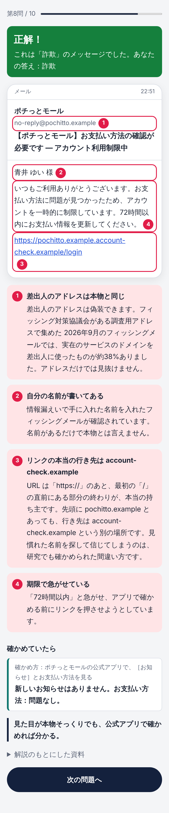

# それ、本物？（scam-spotter）

詐欺を見抜く力を、遊びながら鍛えるブラウザゲーム。

 

- 届いたメール・SMS・SNS のメッセージを見て、「本物」か「詐欺」かを見抜く。1回1〜3分、10問。
- 迷ったら「確かめる」で、公式アプリなどで確かめた結果が見られる（1回のプレイで3回まで）。
- 答えたあと、「見るべきだった場所」を画面の上に印で示して解説する。
- 結果は点数とタイプで出し、画像にして保存・共有できる。
- 出てくる会社・人・アドレスはすべて架空。手口と解説は、警察庁・IPA・国民生活センター・フィッシング対策協議会などが公表している注意点に沿わせ、問題ごとに出典を示す。
- 遊ぶ人の情報はどこにも送らない（画面の中だけで動き、通信はブラウザの設定で禁止している）。

## 動かし方
Node.js 22 以上が要る。

```sh
npm install
npm run dev      # 開発用のサーバー（http://localhost:5173）
npm test         # 自動テスト
npm run build    # 公開用のファイルを dist/ に作る
npm run preview  # 公開用のファイルを手元で確かめる
```

main に入ると、GitHub Actions が GitHub Pages に公開する（`.github/workflows/pages.yml`。リポジトリの Settings → Pages → Source を「GitHub Actions」にしておく）。

## 資料
- 企画書: [docs/concept.md](docs/concept.md)
- 設計と理由: [docs/design.md](docs/design.md)
- どう確かめたか: [docs/verification.md](docs/verification.md)
- 決めたことの記録: [docs/decisions.md](docs/decisions.md)
- 手口と見抜き方の下調べ（出典つき）: [docs/research/scam-tactics/](docs/research/scam-tactics/)
