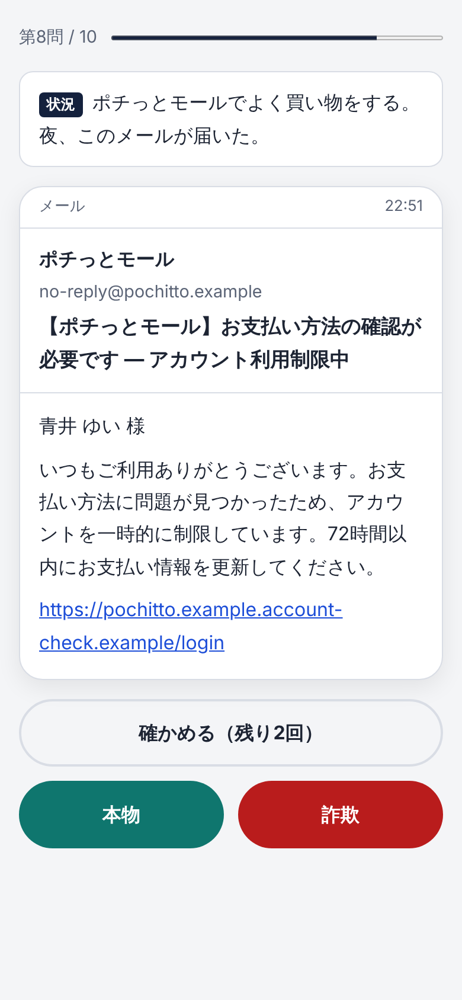

# 設計（第1版・2026-10-23）

企画書（[concept.md](concept.md)）の「最初の版」を形にしたときの、作りと理由。

## 遊び方の流れ
1. はじめの画面で、決まり（架空であること・何も入力しないこと）を読む
2. 10問。1問ずつ「状況」とスマホ（またはパソコンのブラウザ）の画面が出て、「本物」か「詐欺」を選ぶ。問題は16問の置き場から毎回選ぶ（詐欺6問・本物4問、やさしい順）
3. 迷ったら「確かめる」。公式アプリや本人に確かめた結果が見られる（1回のプレイで3回まで）
4. 答えると、見るべき場所に番号つきの印が付き、解説・確かめた結果・1行の学び・出典が出る
5. 最後に点数とタイプ。結果の画像を保存・共有できる

## なぜこの形にしたか

### 「状況」を毎問つける
同じ文面でも、心当たりがあるかで判断が変わる。たとえば振込の確認コードの SMS の問題は、自分で振込をしている最中なら本物、何もしていないのに届いてだれかに聞かれたら詐欺。メッセージだけを見せると「全部疑う」が正解になってしまうので、状況を必ず添える。

### 16問の置き場から、毎回10問を選ぶ
何度遊んでも同じ問題だと、2回目からは答えを覚えるだけになる。置き場（詐欺10問・本物6問）から、1回ごとに詐欺6問・本物4問を選び、やさしい順に並べる。選び方は `src/deck.ts`。

### 本物を4問まぜる
全部が詐欺だと「全部疑う」だけで満点になる（企画書）。また研究では、教材によっては本物のリンクまで避けるようになる副作用が出た（Sheng ら 2010。[下調べ](research/scam-tactics/map.md) の主張6）。本物を見分けることも練習にした。

### 難しさを3段階にした
下調べ（主張7・9）で、URL やアドレスで見抜けるときと、見抜けないときがあると分かった。

| 段階 | 見抜く手がかり | 問題 |
|---|---|---|
| 1 | 送り主・URL が明らかにおかしい／応募していない当選／画面の電話番号／自分の操作の直後のお知らせ | 宅配の不在通知、配達予定（本物）、当選、偽の警告画面、注文確認（本物）、料金未払い |
| 2 | 1文字違いのドメイン・期限で急がせる・0005 の送信元・広告からの投資の誘い・アプリを直接入れさせる | カードの利用制限、料金確定（本物）、支払い方法の更新（本物）、ニセ警察、投資、Android アプリ、カード利用通知（本物） |
| 3 | 差出人は本物と同じ・名前入り・友だちのアカウント。見た目では分からず、確かめる行動が答え | 友だちの乗っ取り、通販の支払い確認、振込の確認コード（本物） |

### 「確かめる」を遊びにした（3回まで）
公的機関が勧めているのは、見た目で見抜くことより「リンクを開かず、公式アプリやブックマークから確かめる」こと（下調べの主張4）。だから確かめる行動そのものをボタンにした。
回数を無制限にすると、毎回押すだけで満点になり、見る目を鍛える練習にならない。3回までにして「どれを確かめるか」を考えさせる。（現実には何回でも確かめてよい。このことは結果画面とタイプの助言で伝える）

### リンクは押せるが、どこにもつながらない
押したことを記録し、結果で「本物のスマホなら偽のサイトが開いていたかもしれない」と伝える。現実の行動（つい押す）に気づいてもらうため。

### タイプの決め方
点数だけでなく、間違え方の傾向を返す。危ないほう（だまされやすい）を先に伝える。

| 順 | 条件 | タイプ |
|---|---|---|
| 1 | 50点以下 | これから伸びる |
| 2 | 詐欺を本物と思ったのが2問以上 | すなおすぎ注意 |
| 3 | 本物を詐欺と思ったのが2問以上 | うたがいすぎ注意 |
| 4 | 全問正解 | かくにん名人 |
| 5 | それ以外 | するどい観察眼 |

最初は 1 を最後に置いていたが、10問だと3問以上まちがえた時点でどちらかの偏りが必ず2以上になり、「これから伸びる」に一度もならないことを、テスト（全部の組み合わせを試すもの）で見つけて順番を直した。

## 安全のための作り（CLAUDE.md の決まり）

| 決まり | 作りでどう守ったか | 確かめ方 |
|---|---|---|
| 実在の会社をまねない | 会社はすべて架空（やまびこ運輸など）。画面に実在の社名が出ないことをテストで確かめる | `tests/questions.test.ts` |
| 実在のドメインと重ねない | ドメインは例のために予約された `.example` だけ（RFC 2606。だれも登録できない） | 同上 |
| 電話番号を出さない | 公的機関の注意喚起と同じく「●」で伏せる | 同上 |
| 入力させない | 入力欄・フォームを作らない。ボタンだけで遊ぶ | `tests/safety.test.ts` |
| どこにも送らない | サーバーを持たない。通信のコードを書かない。さらに公開版には CSP（ブラウザへの指示）で `connect-src 'none'` を付け、通信そのものをブラウザに禁止させる | `tests/safety.test.ts`、ブラウザで fetch が止められることを確認 |
| 記録を残さない | localStorage なども使わない。閉じれば消える | `tests/safety.test.ts` |
| 文字を HTML として扱わない | 画面の文字は textContent で入れ、innerHTML を使わない（XSS を防ぐ） | `tests/safety.test.ts` |
| 悪用できる文面を載せない | 文面は公的機関が公表した例の型にとどめ、宛先・URL はすべて架空。解説は「見抜き方」だけを書く | 目で確認 |

## ファイルの分け方
- `src/questions.ts` … 問題データ（10問）と出典
- `src/scoring.ts` … 採点とタイプ（画面に関係しない計算だけなので、テストしやすい）
- `src/phone.ts` … スマホの画面の見た目
- `src/main.ts` … 画面の流れ
- `src/share.ts` … 結果の画像（canvas で、ブラウザの中だけで作る）
- `src/dom.ts` … 画面の部品を安全に作る小さな道具
